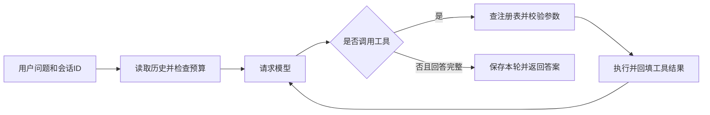

# 最小 Agent Runtime · 光辰智能后端笔试

这是我为这次后端笔试做的一个 Python 命令行 Agent。我把实现重点放在主循环、工具调用和会话管理上，没有使用现成的 Agent 框架。

收到问题后，程序会把问题、历史和工具说明发给模型。模型可以直接回答，也可以提出工具请求，由程序检查参数、执行工具，再把结果发回模型。一次提问可能要经过几次这样的往返。

我做了三个只读工具：计算器、本地资料搜索和文档读取。会话用 SQLite 保存，可以切换会话、继续追问，也能在程序重启后恢复。历史太长时，会保留近期对话，并对旧内容做基础压缩。

开发时我使用了 Codex 辅助编写代码、排查问题和整理说明，具体过程保留在 [AI 使用与问题解决记录](docs/ai-worklog.md) 中。架构题我选择第 4 题作为主答，第 5 题另外整理为补充，入口放在文末。

## 先跑一个离线例子

我保留了不需要密钥的离线模式，方便先检查安装、三个工具和会话切换。

需要 Python 3.11+，我的本地环境是 Python 3.13.9。克隆项目并进入仓库目录后，在 Windows PowerShell 运行：

```powershell
python -m venv .venv
.\.venv\Scripts\python.exe -m pip install -r requirements.txt
.\.venv\Scripts\python.exe -X utf8 -m unittest discover -s tests -v
.\.venv\Scripts\python.exe -X utf8 -m agent --demo
```

依次输入：

```text
计算 (17+25)*3
搜索 Agent
文档 session
/switch window-2
回顾
/switch window-1
回顾
/sessions
/quit
```

这里的计算结果应为 126。切到 `window-2` 后，“回顾”应显示没有历史；切回 `window-1`，可以看到前面的提问。

`--demo` 用固定规则代替模型，只认识“计算”“搜索”“文档”前缀和“回顾”。我用它检查程序流程；自然语言提问，以及“刚才的结果再加 8”这类追问，需要切换到真实模型。

不需要激活虚拟环境或更改 PowerShell 执行策略。macOS/Linux 将可执行文件换成 `.venv/bin/python`。`requirements.txt` 固定直接依赖；`requirements-lock.txt` 保存本次 Python 3.13.9 复现使用的完整依赖版本。

## 使用真实模型

我实际测试的接入使用 Responses API，模型 ID 由接入平台提供。真实模式需要配置自己的地址、模型和密钥；配置有问题时会直接提示错误。

在 Windows 上首次运行，先执行下面的配置命令，按提示输入密钥。输入不会回显，脚本会用当前 Windows 用户的 DPAPI 加密保存到 `.local/private`，这份本地配置没有上传到仓库。

```powershell
.\.venv\Scripts\python.exe -X utf8 -m scripts.configure_model --base-url https://your-provider.example/v1 --model your-model-id
```

配置成功后启动；以后在同一 Windows 用户下直接运行这一条即可：

```powershell
.\.venv\Scripts\python.exe -X utf8 -m agent --config-dir .local/private
```

配置脚本不内置地址和模型，需要显式传入 `--base-url`、`--model`；协议默认 Responses，也可以用 `--protocol` 指定。推理强度默认不发送，只有所选模型明确支持时才加上 `--reasoning-effort low`。把上面的占位地址和模型换成你自己的，是否支持该协议和模型，以自己的服务商为准。

<details>
<summary>使用环境变量配置（其他系统或临时运行）</summary>

也可以不保存配置，通过环境变量运行。下面是 PowerShell 示例：

```powershell
$env:AGENT_BASE_URL='https://your-provider.example/v1'
$env:AGENT_MODEL='your-model-id'
$env:AGENT_PROTOCOL='responses'
$env:AGENT_AUTH='bearer'
# 只有模型支持推理强度时才设置，例如：
# $env:AGENT_REASONING_EFFORT='low'
$env:AGENT_MAX_OUTPUT_TOKENS='2400'
$env:AGENT_TIMEOUT_SECONDS='90'
$secureKey = Read-Host '输入 API Key（不会回显）' -AsSecureString
$credentialForAgent = [System.Net.NetworkCredential]::new('', $secureKey)
$env:AGENT_API_KEY = $credentialForAgent.Password
try {
    .\.venv\Scripts\python.exe -X utf8 -m agent
} finally {
    Remove-Item Env:AGENT_API_KEY
    Remove-Variable secureKey, credentialForAgent
}
```

可用变量见 [.env.example](.env.example)，程序不会自动加载 `.env`。macOS/Linux 同样可以设置这些环境变量，并使用 `.venv/bin/python -m agent` 启动。

</details>

更换供应商或模型后，需要使用新的 `--data-dir`，避免继续使用原模型留下的不兼容上下文。

我用下面这组输入检查记住信息、计算追问、工具调用和会话切换：

```text
请记住：本会话项目代号是青松42。
项目代号是什么？
请计算 (17+25)*3。
把刚才的计算结果再加8，请用计算器确认。
请在本地资料中搜索Agent，并读取session文档。
/switch window-2
当前会话此前约定的项目代号是什么？如果没有，请回答未知。
/switch window-1
项目代号和最近一次计算结果分别是什么？
/quit
```

模型每次的措辞可能不同，主要看代号、计算结果和实际工具记录是否正确。这里的 `search` 只查询项目自带的本地资料，不能搜索互联网或实时消息。

## 我怎样实现这个流程

主循环写在 `agent/runtime.py` 的 `Runtime._run` 中。每次收到模型回复，先看有没有工具请求：有就检查并执行，再带着结果请求模型；没有工具请求且回答完整，就保存本轮并返回答案。



我把“模型提出请求”和“程序实际执行”分开处理。工具名必须已经注册，参数也要通过 JSON Schema 校验，才能执行对应函数。工具报错后，会把错误结果交回模型，让它修正参数或解释原因；HTTP 请求失败、回复被截断，或者只返回进展说明时，则结束当前运行并提示错误。

| 文件 | 内容 |
|---|---|
| `agent/runtime.py` | 主循环、模型调用次数限制、工具结果回传、运行状态 |
| `agent/tools.py` | 注册工具、JSON Schema 校验、受限算术、本地搜索、白名单文档 |
| `agent/responses_provider.py`、`provider.py`、`models.py` | 统一模型接口、HTTP 传输和两种协议的转换 |
| `agent/memory.py` | SQLite 会话读写、历史压缩和保存时的版本检查 |
| `agent/trace.py` | 运行步骤、工具名、状态和耗时记录 |
| `agent/__main__.py`、`demo.py` | 命令行入口和离线模式 |

会话管理上，我用 `(user_id, session_id)` 区分历史。每次提问先读取当前会话，请求模型前再检查上下文长度。发给模型的内容依次是：系统规则、标注为历史背景的摘录、最近几轮完整对话、当前问题及其工具结果。只有模型给出最终答案后才保存本轮；失败状态会返回给用户，但不会混进后续对话历史。

我按完整的一轮处理历史，避免只保留工具请求，却丢掉对应结果。超出限制时，先移除较早轮次并提取部分内容作为摘要；摘要也放不下时继续淘汰。这样能控制上下文大小，但会丢失信息，不能当作长期可靠的业务记录。具体做法见 [记忆设计](docs/memory-design.md)。

默认每次提问最多请求模型 6 次，每次模型回复最多接受 4 个工具调用；保留最近 6 个完整轮次，上下文预算为 18000 字符，摘要预算为 2400 字符。这里限制的是程序内部序列化后的字符数，不是精确的 token 数。

## 我做了哪些检查

我把不需要模型的测试和真实 API 检查分开，方便定位是程序逻辑的问题，还是模型接入的问题。

| 检查 | 结果 |
|---|---|
| 离线自动测试 | 2026-10-21，65 项通过 |
| 真实模型调用 | 2026-10-09，6 项场景通过、8 次 HTTP 请求；2026-10-21 两次复核都在首个请求收到上游 HTTP 502，均未自动重试 |
| 干净目录复现 | 2026-10-21，重新安装依赖，检查三个工具、会话切换和进程重启后的历史恢复，通过 |

运行输出和之前遇到的失败记录都保留在 [verification](verification/README.md)。这些结果对应记录中的环境和版本；更换模型后需要重新检查。

离线测试命令就是前面的 `python -m unittest discover -s tests -v`，不会请求真实模型。需要重新检查真实接入时，可以运行：

```powershell
.\.venv\Scripts\python.exe -X utf8 -m scripts.live_smoke --saved-config-dir .local/private --output verification/live-smoke-new.json
```

这条命令会请求真实 API，最多 12 次 HTTP 请求，不自动重试，遇到失败提前停止。每次复测换一个输出文件名，保留旧记录；如果用环境变量配置，就省略 `--saved-config-dir`，并在清除密钥前执行。

脚本检查普通追问、三个工具、计算结果追问、会话隔离，以及压缩后重新加载会话。重新加载是在同一进程中进行的；真正退出再启动的检查放在复现脚本里：

```powershell
.\.venv\Scripts\python.exe -X utf8 -m scripts.verify_release
```

它会打包源码、解压到新目录、创建虚拟环境并安装依赖，再运行测试和命令行检查，不请求真实模型。

## 目前的限制

这次我实现的是命令行版本，三个工具都是同步、只读执行，没有线上鉴权、订单或支付业务。`--user` 只是本地演示时区分用户的标识。

工具执行目前没有通用的超时隔离；HTTP 超时也不等于整项任务的总时间限制。SQLite 的版本检查可以防止旧状态覆盖新状态，但不能保证多个进程只执行一次工具。历史压缩会丢信息，旧摘要也可能被删除。

离线和真实模式的数据分别保存在 `.local/demo/` 和 `.local/live/`。SQLite 会保存对话正文；日志只记步骤、工具名、错误代码和耗时，不写正文、参数或密钥。日志写入失败时会提示并继续，数据库故障则提示错误，不自动清空历史。

另外，我保留了 `AGENT_PROTOCOL=messages` 兼容分支，只支持普通文本和工具调用。遇到 `thinking` 或 `redacted_thinking` 会返回 `model_unsupported_thinking`。前面的真实调用记录只验证了 Responses 接入。

## 架构题和其他说明

架构题我选择 [第 4 题：幂等与重试](docs/architecture-q4.md)作为主答，重点讨论“订单成功但响应丢失时，怎样避免重复下单”。[第 5 题：Agent 与后端的数据一致性](docs/architecture-q5.md)是补充，讨论业务事实、任务进度和对话记忆分别由谁维护。两份都是设计回答，订单相关能力没有加入当前程序。

我还整理了几份说明，方便对照代码阅读：

- [跟读讲解](docs/walkthrough.md)：沿着一次计算和追问看代码。
- [原题与实现对应关系](docs/requirements.md)：各项要求对应哪些文件和测试。
- [两道架构题的详细说明](docs/architecture-defense.md)：设计取舍和故障场景推演。
- [AI 使用与问题解决记录](docs/ai-worklog.md)：开发过程、遇到的问题和取舍。
- [关键 Prompt 记录](docs/prompts.md)：当时实际使用的任务提示，以及采纳和拒绝的理由。
