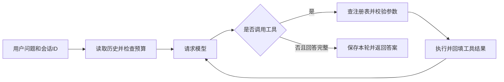

# 自写最小 Agent Runtime · 光辰智能后端笔试

这个程序能接收问题，让模型选择直接回答或调用工具，再把工具结果交回模型继续处理。主循环使用 Python 自行实现，提供计算器、本地模拟搜索和文档读取三个工具；会话保存在 SQLite 中，支持切换、追问和基础压缩。

运行结果及对应版本见 [验证记录](verification/README.md)，题目与代码的对应关系见 [验收映射](docs/requirements.md)。架构材料以[第 4 题：幂等与重试](docs/architecture-q4.md)为主答，[第 5 题：数据一致性](docs/architecture-q5.md)为补充；[AI 使用与问题解决记录](docs/ai-worklog.md)说明开发过程。

## 先运行一个不需要密钥的例子

需要 Python 3.11+，本机使用 Python 3.13.9。Windows PowerShell 在本目录运行：

```powershell
python -m venv .venv
.\.venv\Scripts\python.exe -m pip install -r requirements.txt
.\.venv\Scripts\python.exe -X utf8 -m unittest discover -s tests -v
.\.venv\Scripts\python.exe -X utf8 -m agent --demo
```

依次输入：

```text
计算 (17+25)*3
搜索 Agent
文档 session
/switch window-2
回顾
/switch window-1
回顾
/sessions
/quit
```

计算结果应为 126；新会话没有旧会话的提问，切回后仍能看到原历史。`--demo` 使用固定规则模拟模型，只认识“计算”“搜索”“文档”前缀和“回顾”，适合检查程序是否装配正确。自然语言理解和“刚才的结果再加 8”这类追问，请用下面的真实模式。

不需要激活虚拟环境或更改 PowerShell 执行策略。macOS/Linux 将可执行文件换成 `.venv/bin/python`。`requirements.txt` 固定直接依赖；`requirements-lock.txt` 保存本次 Python 3.13.9 复现使用的完整依赖版本。

## 使用真实模型

当前主线使用 Responses API，已验证的接入模型 ID 为 `gpt-6.1-sol`。运行时需要显式配置平台与密钥；配置失败会报错，不自动切换到模拟模式。

在 Windows 上首次运行真实模型时，先运行下面命令，按提示输入密钥。脚本默认使用 `https://api.anmoxuan.xyz/v1`、gpt-6.1-sol 和 Responses；其他接入可通过 `--base-url`、`--model`、`--protocol` 指定。密钥输入不回显，使用当前 Windows 用户的 DPAPI 加密保存；配置不包含在仓库或交付包中。

```powershell
.\.venv\Scripts\python.exe -X utf8 -m scripts.configure_model
```

配置成功后启动；以后在同一 Windows 用户下可以直接使用此命令：

```powershell
.\.venv\Scripts\python.exe -X utf8 -m agent --config-dir .local/private
```

也可以通过环境变量配置，适合其他系统或临时使用。PowerShell 示例：

```powershell
$env:AGENT_BASE_URL='https://api.anmoxuan.xyz/v1'
$env:AGENT_MODEL='gpt-6.1-sol'
$env:AGENT_PROTOCOL='responses'
$env:AGENT_AUTH='bearer'
$env:AGENT_REASONING_EFFORT='low'
$env:AGENT_MAX_OUTPUT_TOKENS='2400'
$env:AGENT_TIMEOUT_SECONDS='90'
$secureKey = Read-Host '输入 API Key（不会回显）' -AsSecureString
$credentialForAgent = [System.Net.NetworkCredential]::new('', $secureKey)
$env:AGENT_API_KEY = $credentialForAgent.Password
try {
    .\.venv\Scripts\python.exe -X utf8 -m agent
} finally {
    Remove-Item Env:AGENT_API_KEY
    Remove-Variable secureKey, credentialForAgent
}
```

`.env.example` 说明可用变量，程序不会自动加载 `.env`。`--config-dir` 只读取明确指定的目录，不扫描其他应用。更换供应商或模型后请使用新的 `--data-dir`，避免复用不兼容的加密上下文。

真实交互可以依次输入：

```text
请记住：本会话项目代号是青松42。
项目代号是什么？
请计算 (17+25)*3。
把刚才的计算结果再加8，请用计算器确认。
请在本地资料中搜索Agent，并读取session文档。
/switch window-2
当前会话此前约定的项目代号是什么？如果没有，请回答未知。
/switch window-1
项目代号和最近一次计算结果分别是什么？
/quit
```

模型的措辞可能不同，应检查实际结果和工具记录。search 查询的是项目自带的模拟资料，不是互联网搜索。

## 从输入到回答



`Runtime._run` 控制这个循环。模型提出调用，工具注册表负责校验和执行，适配器负责把内部消息转换成 HTTP 协议。工具失败会作为结构化结果回传，模型可以纠正参数；HTTP 失败、响应截断和只有进展说明的响应会明确结束为错误，不冒充成功。

| 代码 | 主要职责 |
|---|---|
| `agent/runtime.py` | 有界循环、结果回填、结束状态、同一实例内的会话运行保护 |
| `agent/tools.py` | 注册工具、JSON Schema 校验、受限算术、本地搜索、白名单文档 |
| `agent/responses_provider.py`、`provider.py`、`models.py` | 统一模型接口、HTTP 传输和两种协议的转换 |
| `agent/memory.py` | SQLite 保存与召回、完整轮次压缩、摘要淘汰、保存版本检查 |
| `agent/trace.py` | 按运行 ID 记录步骤、结果状态和耗时 |
| `agent/__main__.py`、`demo.py` | 命令行装配和离线模拟模型 |

每次提问先按 `(user_id, session_id)` 读取历史；每次请求模型前再次检查长度。模型收到的顺序是：固定系统规则、标注为历史背景的摘录、最近完整轮次、当前问题及其工具结果。本轮结束后保存，所以下次提问和程序重启后都能继续读取。详细取舍见 [记忆设计](docs/memory-design.md)。

默认每轮最多请求模型 6 次、每次最多 4 个工具调用；保留最近 6 个完整轮次，内部上下文预算为 18000 字符，摘要预算为 2400 字符。字符预算用于限制程序输入规模，不是精确 token 估算。

## 验证与使用边界

默认 unittest 全部离线。真实验收单独执行，使用合成问题、最多 12 次 HTTP 请求、无自动重试，失败时提前停止。使用本机加密配置的完整命令：

```powershell
.\.venv\Scripts\python.exe -X utf8 -m scripts.live_smoke --saved-config-dir .local/private --output verification/live-smoke-new.json
```

每次复测使用新的输出文件名。环境变量方式则省略 `--saved-config-dir`，并在清除密钥之前执行。脚本检查普通追问、三个工具的实际结果、工具追问、会话隔离和压缩后重新加载会话。真正退出进程再启动的检查包含在离线交付复现中：

```powershell
.\.venv\Scripts\python.exe -X utf8 -m scripts.verify_release
```

复现脚本会创建源码 ZIP，在新虚拟环境安装依赖并检查测试与 CLI，不请求真实模型。

数据位于 `.local/demo/` 或 `.local/live/`，两种模式分开保存。SQLite 包含会话正文；trace 只记录运行、步骤、工具名、错误代码和耗时等元数据，不记录正文、参数或密钥。运行期间日志写入失败会提示并继续；数据库故障会提示，不自动清空历史。

当前实现有几个明确限制：摘要有损且会淘汰；三个工具同步执行，没有通用超时隔离；HTTP 超时不是整项任务的绝对截止时间；SQLite revision 防止覆盖，不保证跨进程只执行一次。`--user` 是本地演示标识，尚无线上鉴权或订单业务。

`AGENT_PROTOCOL=messages` 保留为有限兼容分支，只支持普通文本与工具调用；包含 `thinking` 或 `redacted_thinking` 的响应会返回 `model_unsupported_thinking`。当前真实验收采用 Responses，不代表旧协议和所有模型都已验证。

## 阅读顺序

先看 [跟读讲解](docs/walkthrough.md)，顺着一次计算和追问定位代码；再看 [第 4 题主答](docs/architecture-q4.md)与[第 5 题补充](docs/architecture-q5.md)。[两题详细讲解与答辩练习](docs/architecture-defense.md)解释术语、故障推演和深入追问。[AI 使用记录](docs/ai-worklog.md)保留开发过程中的取舍、问题和验证结果。
