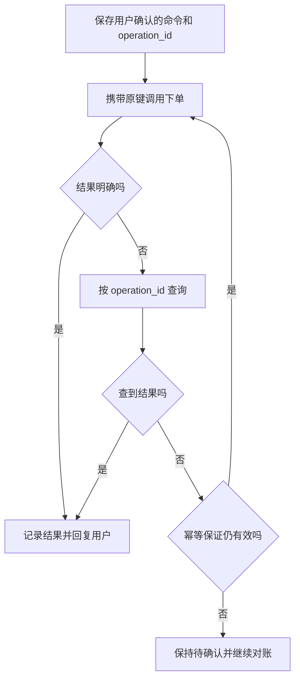

# 第 4 题主答：怎样避免重试造成重复下单

> 题目：工具调用超时后重试，怎样避免重复下单？Agent 框架怎样知道一个工具是否幂等？

以下是架构设计，不是当前项目已经实现的功能。当前项目只有 calculator、mock search 和 read_docs 三个只读工具；详细故障推演见[共用说明](architecture-defense.md)。

用户确认购买后，Agent 调用下单工具。订单服务可能已经创建订单，但响应在网络中丢失。Runtime 只看到超时，无法判断订单是否成功；如果把它当成新操作再下单，就可能重复购买。因此，我会让一次已确认的购买始终使用同一个业务操作 ID，并让订单服务负责去重。

这三个 ID 不能混为一谈：

| ID | 作用 |
| --- | --- |
| `tool_call_id` | 把工具结果配回这一次模型调用；模型重试后可能改变 |
| `operation_id` | 标识用户确认的这一次购买；查询和安全重试时保持不变 |
| `order_id` | 订单服务创建订单后返回的业务编号 |

首次调用前，应用保存用户确认的命令和 `operation_id`。订单服务对 `(tenant_id, operation_type, operation_id)` 建唯一约束：同键同参返回原结果，同键异参返回冲突。若操作记录和订单在同一数据库，就在一个事务中保存操作记录、创建订单并记录结果。这样事务提交前崩溃会回滚；提交后响应丢失，重试能查回原订单。跨外部服务时，本地事务不够，下游也必须提供有效的幂等键和结果查询能力。

超时后先按 `operation_id` 查询。查到确定结果就更新任务并答复；仍然未知时，只有下游明确保证同键同参不会重复产生副作用、且幂等键仍在有效期内，才用原命令和原键重试。没有这项保证，就保留“待确认”，继续查询或人工对账。**可以重试不等于已经成功。**

Runtime 只按开发者配置的工具策略决定能否重试，例如 `read_only`、`keyed`、`none`，并设置错误范围、次数和总时间预算；模型不能自行声明工具幂等。参数、权限错误不重试，网络错误或部分服务错误也要先检查执行状态和下游契约。策略只是调度依据，真正的去重保证来自业务服务及其数据约束。当前项目不自动重试任何 HTTP 请求。

验证时，我会检查同键并发是否只创建一单、同键异参是否冲突、提交成功但响应丢失能否查回原单，以及结果未知且幂等保障失效时是否停止重发。租约、键清理、退避和更完整的故障矩阵放在[详细讲解](architecture-defense.md)中。
