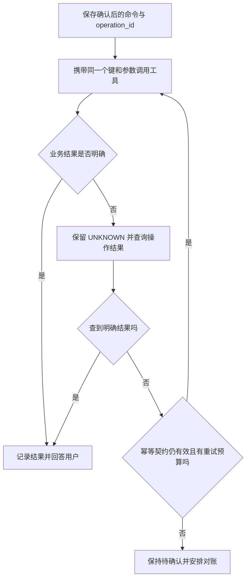

# 第 4 题主答：Agent 的幂等性与重试

> 题目：LLM 输出是非确定性的，工具调用可能超时。重试一次工具调用时，怎么保证不产生副作用（比如重复下单）？如何让 agent 框架感知这个工具是幂等的？

以下用下单说明设计。当前项目实现的是三个只读工具，没有订单服务或幂等中间件；本文中的订单流程和工具策略尚未实现。第 5 题沿用这个例子，讨论[业务数据与 Agent 状态如何分工](architecture-q5.md)，深入追问见[共用讲解稿](architecture-defense.md)。

用户要买一件商品。Agent 发出下单请求，服务端已经创建订单，但返回结果的网络断了。Agent 看到超时，却不知道订单是否成功。如果直接换一个请求再下单，就可能买两件。

我会让应用先确定这次购买的身份，让订单服务保证同一操作只创建一笔订单，再由 Runtime 决定如何重试。这样即使模型换了一种说法，也不会因此变成一笔新订单。

## 先确定“这是同一次购买”

首次执行前，应用保存用户已确认的订单命令，并分配稳定的 `operation_id`。重试和进程恢复都读取这条记录，不重新让模型生成订单参数。

| 标识 | 在例子中的作用 |
| --- | --- |
| `tool_call_id` | 把工具结果配回模型调用；模型重新生成时可能改变 |
| `operation_id = op_001` | 标识这次购买，跨重试保持不变，由应用维护 |
| `order_id = order_100` | 订单服务真正创建的订单编号 |

`operation_id` 应绑定到一次已接受的业务意图，例如用户确认的一次结算请求。两个参数完全相同的订单，也可能是用户确实想买两次，因此不能只用参数哈希决定是否重复。用户明确提出新购买时才分配新操作 ID；无法分辨是在催问原订单还是要再买一份时，先澄清。

## 在订单服务里完成去重

服务端先鉴权，再按 `(tenant_id, operation_type, operation_id)` 查找或原子建立操作记录。租户身份来自可信登录上下文。记录保存规范化参数摘要、执行状态和结果：同键同参返回原结果，同键异参返回冲突，不能悄悄改成新订单。

“先查没有，再插入”会被并发请求同时通过，所以要用数据库唯一约束。若订单和操作记录位于同一个数据库，我会在一个事务里完成操作键占用、业务校验、订单创建及成功结果保存，并给订单的来源操作键加唯一约束。提交前崩溃就一起回滚；提交成功但响应丢失，重试能查回 `order_100`。

已有操作正在处理时，重复请求等待或返回处理中；已经得到确定性失败时，返回该操作的失败结果。执行状态不明确时进入 `UNKNOWN`，按下面的恢复流程处理。参数相同和参数规范化的细节放在讲解稿中。

## 超时后先查证，再按契约决定是否重发

超时只说明没有及时收到结果，不能证明订单没有创建。这也是 AWS 在重试设计中强调的边界。[AWS：超时、重试和抖动回退](https://aws.amazon.com/cn/builders-library/timeouts-retries-and-backoff-with-jitter/)

如果订单由外部服务创建，本地事务无法同时提交远端订单。需要下游也支持固定幂等键，并能按操作 ID 或业务引用查询结果。

查到订单，就记录成功；查到确定性拒绝，就记录失败。仍然查不清时，只有下游保证当前键仍有效、同键同参不会重复产生业务效果，才允许重发原命令。**结果仍是未知，也可以在有效幂等契约下同键重试；允许重试不等于已经确认成功。** 查询暂时查不到，可能只是数据尚未同步，不能单独作为“未执行”的证据。

如果缺少这样的契约，就保留待确认状态，通过后续查询或人工对账解决，不换一个新键继续下单。Stripe 的接口展示了同键结果重放、异参拒绝等规则，也明确了键清理后的行为；接入时必须核实实际下游提供的保证。[Stripe：Idempotent requests](https://docs.stripe.com/api/idempotent_requests)

## Runtime 怎样知道工具能否重试

由开发者在工具注册时维护策略，Runtime 读取策略后执行。模型不能自行给工具贴上“幂等”标签。下面是拟增加的策略字段，不是当前代码已有的接口：

| 字段示例 | Runtime 如何使用 |
| --- | --- |
| `idempotency = read_only / keyed / none` | 区分只读、有幂等键保障、没有重试保障的工具 |
| `operation_kind = create_order` | 从可信任务记录取固定操作 ID 和原命令 |
| `status_query = get_operation_result` | 结果未知时先按操作 ID 查询 |
| 重试错误类型、次数和时间预算 | 只在条件满足且预算尚有时重试 |

只读工具遇到瞬态故障可以重试；`keyed` 工具必须实际具备服务端保证；`none` 的写工具禁止自动重试。策略声明用于调度，数据库和下游契约才提供保证。

参数错误、权限错误、同键异参等不应原样重试。429、部分 5xx 和网络故障只是候选原因，还要检查执行状态和幂等条件。重试由一层统一管理，设置单次超时、总时限和最多尝试次数，并使用有上限的退避加随机抖动，避免同时反复请求。预算耗尽时，未知结果仍报告待确认。[AWS：重试与退避](https://aws.amazon.com/cn/builders-library/timeouts-retries-and-backoff-with-jitter/)

验证时我会优先检查：同键并发是否只创建一单、同键异参是否拒绝、提交成功但响应丢失能否找回原单、外部结果未知时是否误换新键。详细故障矩阵及租约、过期清理等问题见[共用讲解稿](architecture-defense.md)。这些是将来实现订单能力的验收计划，不属于当前只读工具项目已经通过的测试。
